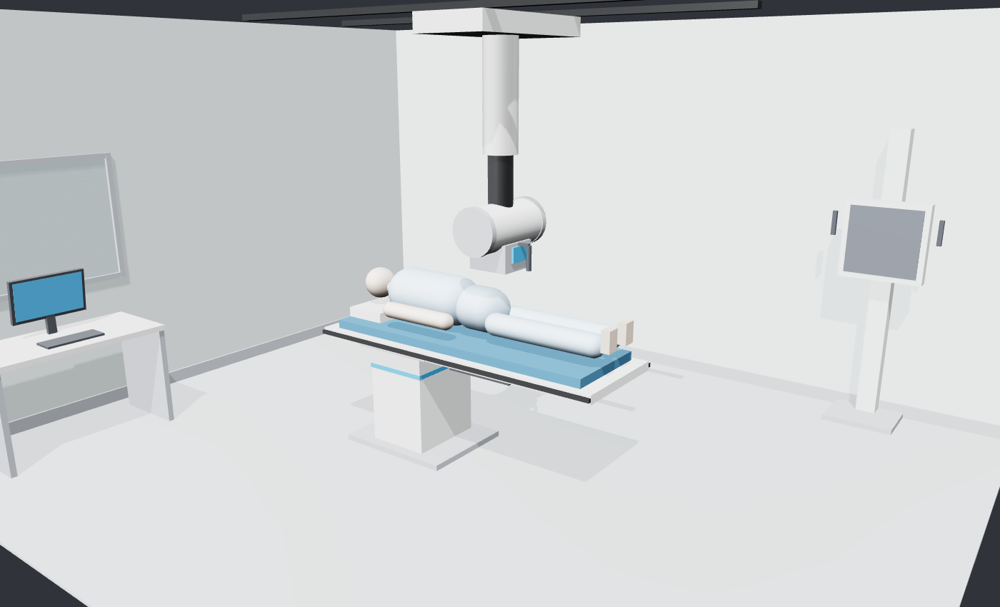
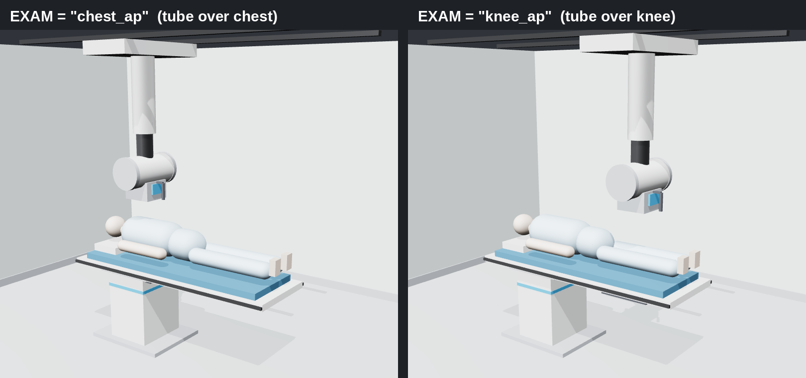
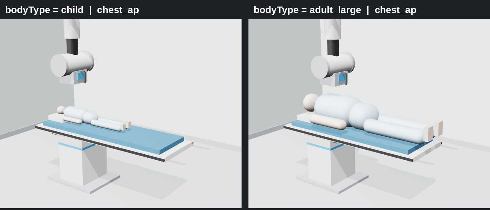
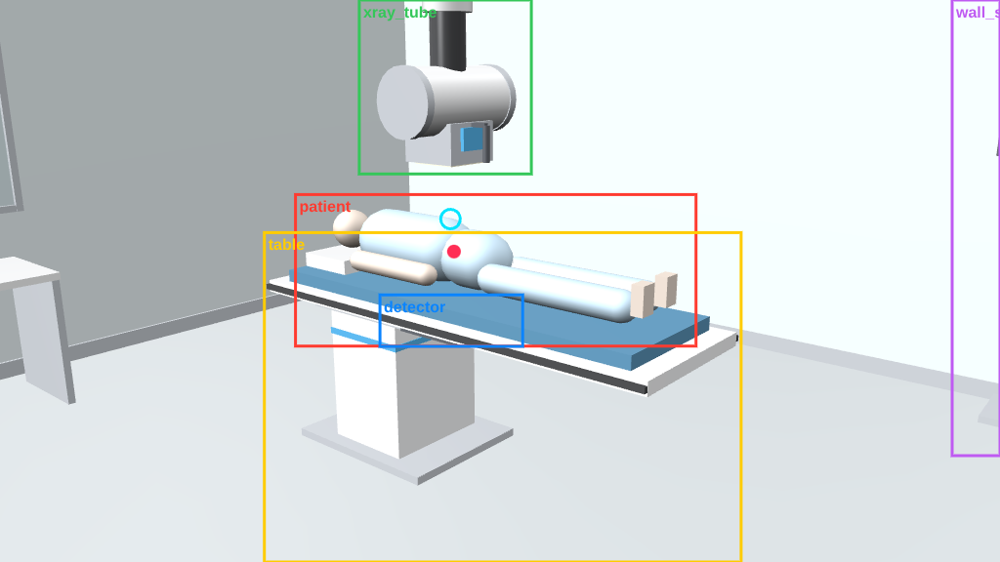

# RadTwin

**A digital twin simulation platform prototype for autonomous X-ray imaging**, built on NVIDIA Omniverse and OpenUSD.

RadTwin simulates an X-ray exam room, its imaging equipment and a population of virtual patients.
Exam orders drive autonomous positioning; every scenario is checked for safety, logged, rendered and
turned into labelled synthetic data, DICOM output and model benchmarks for AI teams.

## What it does

| Step | Script | Result |
|---|---|---|
| 1. Build the exam room twin | `build_exam_room_v2.py` | Room, ceiling-mounted X-ray tube, patient table, detector, wall stand, operator console; PBR materials; `radtwin:*` twin attributes; PhysX colliders |
| 2. Create the patient population | `patient_variants.py` | One patient asset with a `bodyType` variant set: child, adult small / medium / large (scale, mass, height) |
| 3. Position autonomously | `auto_position.py` | Protocol-driven table height, tube travel and SID; collision clearance check; state written back to the twin |
| 4. Validate every scenario | `scenario_runner.py` | 4 patients x 5 exams run automatically; CSV log + screenshot per scenario |
| 5. Generate synthetic data | `generate_dataset.py` | Randomised poses and cameras; auto labels (boxes, keypoints, beam offset); per-frame metadata; versioned manifest with splits and SHA-256 hashes; labelling rules |
| 6. Speak hospital standards | `hl7_to_dicom.py` | HL7 v2 order in, DICOM out, de-identified copy, compliance notes |
| 7. Benchmark a model | `benchmark.py` | Learned model vs no-correction baseline, broken down by patient group and exam |

## Requirements

- Windows 11, NVIDIA RTX GPU (developed on an RTX 3060 Laptop GPU, 6 GB VRAM, 16 GB RAM)
- An Omniverse Kit app built from [NVIDIA's Kit App Template](https://github.com/NVIDIA-Omniverse/kit-app-template)
  (USD Composer template, Kit 110.4) with the PhysX UI extension enabled
- Internet once, for `hl7_to_dicom.py` to install `pydicom` and `Pillow` into Kit's Python

## How to run

Open your stage (e.g. `exam_room.usd`), stop physics, then run each script in **Window > Script Editor** in this order:

1. `build_exam_room_v2.py`
2. `patient_variants.py` (switch patients later in the Property panel, Variants section)
3. `auto_position.py` (set `EXAM` at the top)
4. `scenario_runner.py`
5. `generate_dataset.py` (use `NUM_FRAMES = 200`, `RESOLUTION = (512, 288)` before benchmarking)
6. `hl7_to_dicom.py` (edit the HL7 order at the top to try other patients and exams)
7. `benchmark.py`

Outputs are written next to the `.usd` file in `scenario_runs/`, `datasets/` and `hl7_dicom/`.
Every script also runs outside Omniverse with `usd-core` for testing: `python script.py stage.usda`.

## Patient variants

## Synthetic data labels

Labelling rules ship with every dataset (`LABELLING.md`); see [ADR-0004](docs/adr/0004-dataset-contract.md) for the data contract.

## Architecture

The prototype runs on one workstation. The production design (Azure: API gateway, exam and scenario
services, event bus, headless Omniverse GPU workers, dataset lake, DICOM service, Azure ML) is in
[docs/ARCHITECTURE.md](docs/ARCHITECTURE.md), with decisions in [docs/adr](docs/adr),
risks in [docs/RISKS.md](docs/RISKS.md) and phases in [docs/ROADMAP.md](docs/ROADMAP.md).

## Limits (honest list)

- Patients are parametric stand-ins, not anatomical models.
- Images are RGB views of the room, not simulated radiographs; DICOM files are marked synthetic (`ConversionType = SYN`).
- De-identification is a basic subset of DICOM PS3.15.
- Positioning and twin logic are duplicated across scripts; phase 1 of the roadmap packages them as one Kit extension.
- Images in this README are preview renders; Omniverse RTX output looks better.

## Author

T Sai Jeevan Babu · [Portfolio](https://jeevan-babu-portfolio.vercel.app/) · saijeevanbabu@gmail.com
