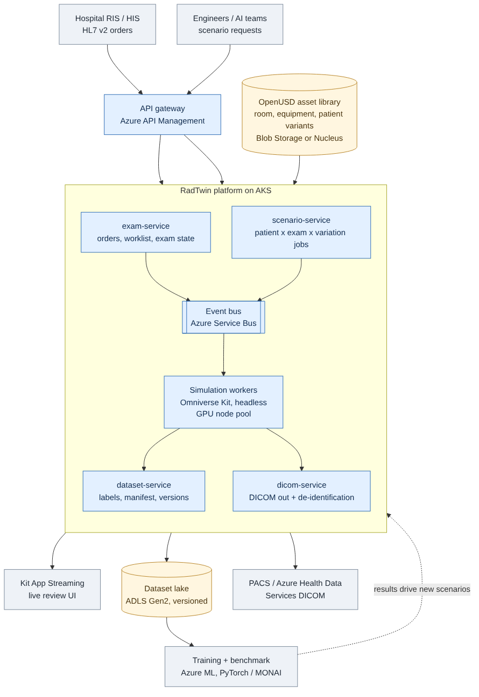

# RadTwin architecture

RadTwin is a digital twin simulation platform for developing and validating **autonomous X-ray imaging**:
virtual patients, an exam room, imaging equipment and radiology workflows generate labelled synthetic
data and validation evidence for AI teams.

This document separates **what the prototype does today** from **the production design** it is built to grow into.

## 1. Prototype (built)

Runs on one laptop (RTX 3060 6 GB, 16 GB RAM) inside an Omniverse Kit app built from NVIDIA's Kit App Template.

| Capability | Script | JD responsibility covered |
|---|---|---|
| Exam room, ceiling X-ray tube, table, detector, wall stand, console as OpenUSD prims with materials, custom twin attributes and PhysX colliders | `build_exam_room_v2.py` | Examination room environments; imaging equipment twins |
| Patient asset with a `bodyType` variant set (child, adult small / medium / large) carrying scale, mass, height | `patient_variants.py` | Virtual patient avatars for diverse populations |
| Protocol-driven positioning: table height, tube travel, SID; collision clearance rule with automatic SID adjustment or BLOCKED state | `auto_position.py` | Autonomous imaging operations; patient positioning |
| Every patient x every exam run automatically, results logged to CSV with screenshots | `scenario_runner.py` | Simulation workflows; validation evidence |
| Randomised dataset: pose offsets, camera jitter, auto labels (boxes, keypoints, beam offset), per-frame metadata, versioned manifest with splits and SHA-256 hashes, labelling rules | `generate_dataset.py` | Synthetic data, annotation, metadata, dataset governance |
| HL7 v2 order in, DICOM out, de-identified copy, compliance notes | `hl7_to_dicom.py` | DICOM / HL7 / IHE; healthcare compliance |
| Model benchmark vs baseline, broken down by patient type and exam | `benchmark.py` | AI/ML training, validation, benchmarking |

Prototype limits, stated plainly: patients are parametric stand-ins, not anatomical models; images are
RGB camera views, not simulated radiographs; everything runs locally as Script Editor scripts.

## 2. Production design

**Flow.** Orders (HL7 from a hospital RIS, or scenario requests from engineers) enter through an API gateway.
`exam-service` and `scenario-service` turn them into simulation jobs on an event bus. Headless Omniverse
Kit workers on a GPU node pool pick up jobs, compose the scene from the OpenUSD asset library, run positioning
and physics, render, and hand results to `dataset-service` (labels, manifest, versioning into the dataset lake)
and `dicom-service` (DICOM out, de-identification, PACS / Azure DICOM service). Training and benchmarking in
Azure ML read versioned datasets; their findings (for example, a weak patient group) drive new scenario jobs.
Engineers review live scenes through Kit App Streaming.

### Components

| Component | Responsibility | Technology |
|---|---|---|
| API gateway | Auth, rate limits, versioned APIs | Azure API Management, Entra ID |
| exam-service | HL7 intake, worklist, exam state machine | Python / FastAPI, HL7 parser |
| scenario-service | Expands patient x exam x variation into jobs; priorities; seeds | Python / FastAPI |
| Event bus | Decouples request rate from GPU capacity; retries; dead-letter | Azure Service Bus |
| Simulation workers | Scene composition, positioning, physics, rendering, capture | Omniverse Kit (headless) containers on AKS GPU nodes |
| OpenUSD asset library | Room, equipment, patient assets; variants; layers per team | Azure Blob Storage or Nucleus |
| dataset-service | Labels, metadata, manifest, lineage, version tags | Python, ADLS Gen2 |
| dicom-service | DICOM encoding, PS3.15 de-identification, PACS push | pydicom, Azure Health Data Services |
| Training + benchmark | Model training, per-population metrics, regression gates | Azure ML, PyTorch / MONAI |

### Quality attributes

| Attribute | How the design addresses it |
|---|---|
| Scalability | Stateless workers scale on queue depth; scenarios are independent jobs |
| Extensibility | New equipment or patients = new USD assets / variants; new exams = protocol table entries; new outputs = new consumers on the bus |
| Performance | GPU pool sized per render cost; headless rendering; asset payloads loaded on demand |
| Security | Entra ID, private networking, Key Vault for secrets, no PHI in the simulation path |
| Maintainability | Shared positioning and twin logic packaged as one Kit extension (prototype duplicates it across scripts) |
| Traceability | Every dataset has seed, generator version, source stage, hashes; every run has a log |

## 3. Decisions

- [ADR-0001 OpenUSD as the scene and asset format](adr/0001-openusd-scene-format.md)
- [ADR-0002 Omniverse over Unreal Engine and Unity for the simulation core](adr/0002-simulation-engine-choice.md)
- [ADR-0003 Microservices around an event bus](adr/0003-microservices-event-bus.md)
- [ADR-0004 Dataset contract: images + per-frame JSON + versioned manifest](adr/0004-dataset-contract.md)

See also [RISKS.md](RISKS.md) and [ROADMAP.md](ROADMAP.md).
